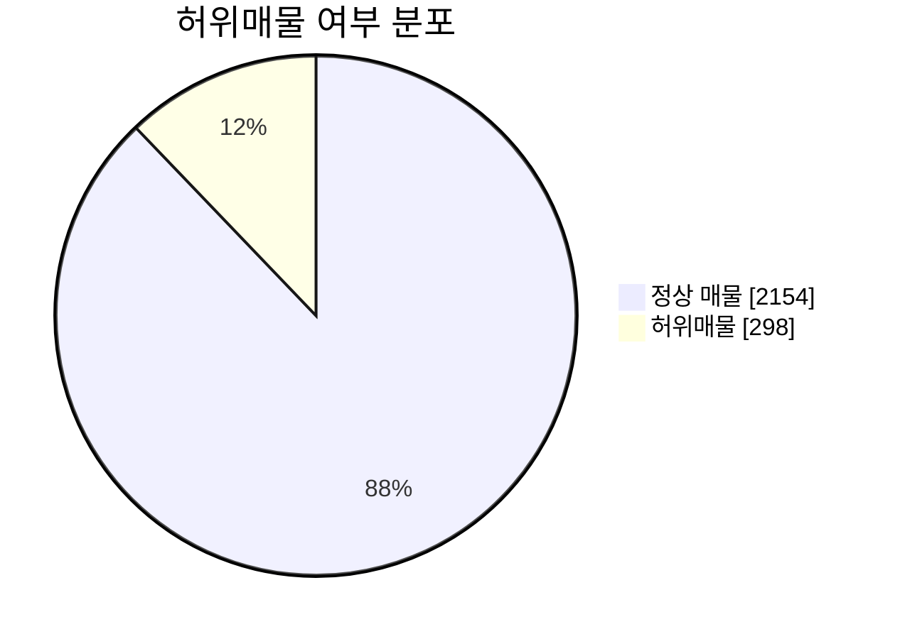
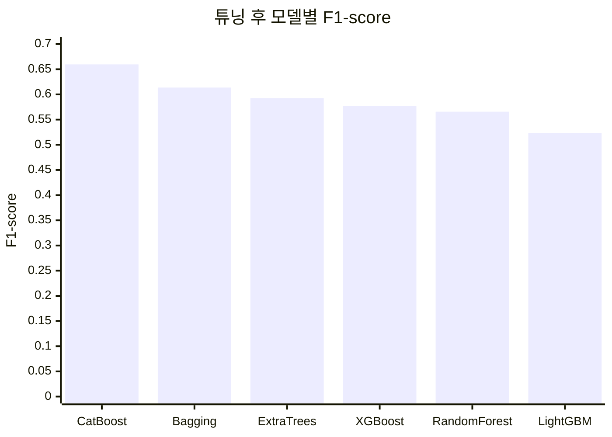
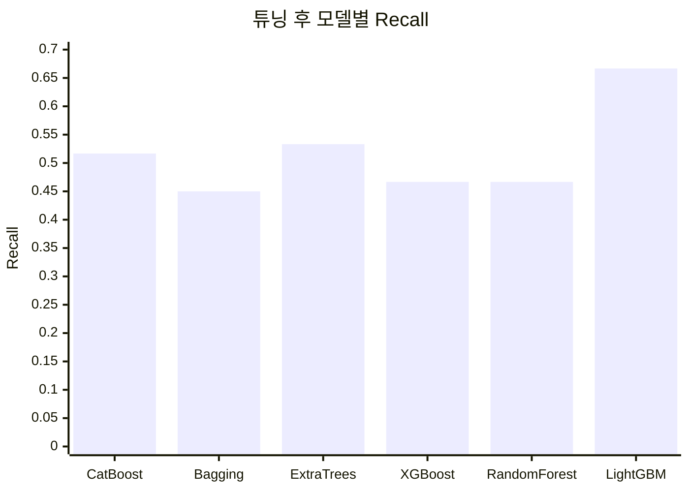
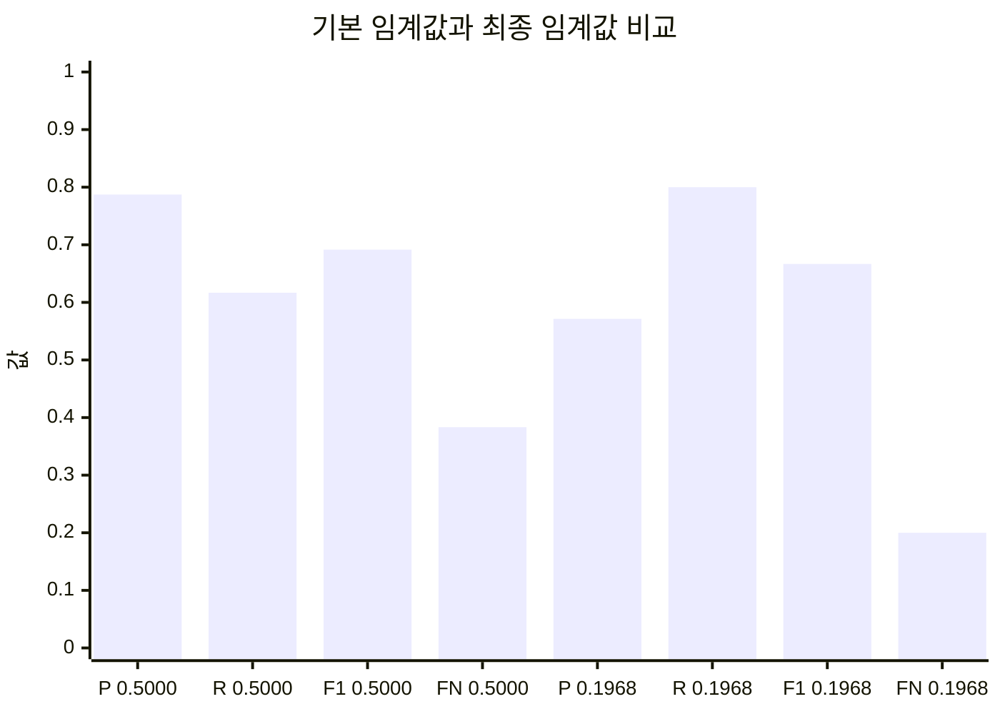

# 허위매물 전처리 및 탐지 모델링

부동산 매물 데이터를 기반으로 허위매물 여부를 예측하는 이진 분류 프로젝트입니다. 데이터 전처리부터 모델 비교, 하이퍼파라미터 탐색, 최종 임계값 조정까지 수행하여 실제 운영 상황에서 허위매물을 놓치지 않는 방향으로 모델을 개선했습니다.

## 프로젝트 개요

- 목표: 매물 정보 기반 허위매물 여부 예측
- 문제 유형: 이진 분류
- 타겟 변수: `허위매물여부`
- 분석 파일: `허위매물 전처리탐지_문제.ipynb`
- 데이터 파일: `train.csv`

## 데이터 구성

전체 데이터는 2,452개 행과 17개 컬럼으로 구성되어 있습니다.

| 구분 | 값 |
| --- | ---: |
| 전체 매물 수 | 2,452 |
| 정상 매물 | 2,154 |
| 허위매물 | 298 |
| 허위매물 비율 | 약 12.2% |

주요 변수는 보증금, 월세, 전용면적, 해당층, 총층, 방향, 방수, 욕실수, 주차가능여부, 총주차대수, 관리비, 중개사무소, 제공플랫폼, 게재일 등입니다.

## 시각화 요약

### 클래스 분포



데이터는 정상 매물이 87.8%, 허위매물이 12.2%인 불균형 구조입니다. 따라서 단순 Accuracy보다 Recall, F1-score, PR-AUC를 함께 확인하는 방식이 적합합니다.

### 데이터 품질 및 그룹별 허위매물 비율

| 항목 | 구분 | 값 | 시각화 |
| --- | --- | ---: | --- |
| 클래스 비율 | 정상 매물 | 87.8% | ██████████████████ |
| 클래스 비율 | 허위매물 | 12.2% | ██ |
| 결측치 | 전용면적 | 32.1% | ██████ |
| 결측치 | 총주차대수 | 28.4% | ██████ |
| 결측치 | 해당층 | 9.3% | ██ |

| 그룹 | 전체 건수 | 허위매물 수 | 허위매물 비율 | 시각화 |
| --- | ---: | ---: | ---: | --- |
| D플랫폼 | 184 | 37 | 20.1% | ████ |
| J플랫폼 | 12 | 2 | 16.7% | ███ |
| C플랫폼 | 350 | 47 | 13.4% | ███ |
| A플랫폼 | 958 | 120 | 12.5% | ██ |
| 현장확인 | 1,705 | 224 | 13.1% | ███ |
| 서류확인 | 365 | 38 | 10.4% | ██ |
| 전화확인 | 382 | 36 | 9.4% | ██ |
| 주차 불가능 | 1,215 | 198 | 16.3% | ███ |
| 주차 가능 | 1,237 | 100 | 8.1% | ██ |

## 분석 과정

### 1. 데이터 분리

타겟 변수 `허위매물여부`를 분리한 뒤, 학습 데이터와 검증 데이터를 8:2 비율로 나누었습니다. 허위매물 비율이 낮은 불균형 데이터이므로 `stratify=y`를 적용해 학습/검증 세트의 클래스 비율이 유지되도록 했습니다.

### 2. 전처리

- 분석에 직접 사용하지 않는 `ID` 컬럼 제거
- `게재일`을 날짜형으로 변환
- 결측치 처리
  - `전용면적`: 중앙값 대체
  - `총주차대수`: 0으로 대체
  - `해당층`, `총층`, `방수`, `욕실수`: 최빈값 대체
- `게재일`에서 파생 변수 생성
  - `month`: 월 정보를 1분기~4분기로 변환
  - `day`: 일자를 초/중/말 구간으로 변환
  - 원본 `게재일` 컬럼 제거
- 범주형 변수 라벨 인코딩
  - `매물확인방식`, `방향`, `주차가능여부`, `제공플랫폼`, `중개사무소`, `month`, `day`
- 파생 변수 추가
  - `면적 대비 방수 = 방수 / 전용면적`

### 3. 기본 모델링

전처리된 데이터를 바탕으로 로지스틱 회귀를 먼저 적용해 기준 성능을 확인했습니다. 기본 검증 결과는 다음과 같습니다.

| 모델 | Accuracy | Precision | Recall | F1 | ROC-AUC |
| --- | ---: | ---: | ---: | ---: | ---: |
| Logistic Regression | 0.8778 | 0.5000 | 0.1667 | 0.2500 | 0.8387 |

기본 모델은 정확도는 높아 보였지만, 허위매물 Recall이 낮아 실제 탐지 목적에는 한계가 있었습니다.

### 4. 모델 비교 및 튜닝

분류 성능을 높이기 위해 GridSearchCV와 RandomizedSearchCV를 활용했습니다. GridSearch는 모든 조합을 탐색해 계산 시간이 오래 걸렸고, RandomizedSearch는 제한된 시간 안에서 좋은 조합을 효율적으로 찾을 수 있어 최종 비교에는 RandomizedSearch 결과를 중심으로 사용했습니다.

비교한 모델은 다음과 같습니다.

- BaggingClassifier
- RandomForestClassifier
- XGBoost
- LightGBM
- CatBoostClassifier
- ExtraTreesClassifier

튜닝 후 기본 임계값 0.5 기준 주요 모델 성능은 다음과 같습니다.

| 모델 | Accuracy | Precision | Recall | F1 | ROC-AUC |
| --- | ---: | ---: | ---: | ---: | ---: |
| CatBoostClassifier | 0.9348 | 0.9118 | 0.5167 | 0.6596 | 0.9164 |
| Bagging(Tree) | 0.9308 | 0.9643 | 0.4500 | 0.6136 | 0.8579 |
| ExtraTreesClassifier | 0.9104 | 0.6667 | 0.5333 | 0.5926 | 0.9215 |
| XGBoost | 0.9165 | 0.7568 | 0.4667 | 0.5773 | 0.8993 |
| RandomForest | 0.9124 | 0.7179 | 0.4667 | 0.5657 | 0.8926 |
| LightGBM | 0.8513 | 0.4301 | 0.6667 | 0.5229 | 0.8833 |

F1-score 기준으로 CatBoostClassifier가 가장 우수해 최종 모델 후보로 선정했습니다.

### 주요 모델 성능 그래프





## 최종 모델

최종 모델은 CatBoostClassifier입니다. 범주형 변수와 비선형 관계가 포함된 데이터에서 안정적인 성능을 보였고, 클래스 불균형을 반영하기 위해 허위매물 클래스에 가중치를 적용했습니다. 이후 early stopping을 사용해 과적합을 완화하고, 검증 데이터 기준으로 최적 모델을 선택했습니다.

주요 설정은 다음과 같습니다.

- `n_estimators=3000`
- `learning_rate=0.05`
- `depth=8`
- `l2_leaf_reg=3`
- `border_count=64`
- `class_weights=[1.0, neg / pos]`
- `eval_metric='AUC'`
- `early_stopping_rounds=200`

## 임계값 튜닝 결과

허위매물 탐지에서는 정상 매물을 일부 허위매물로 잘못 판단하는 것보다, 실제 허위매물을 놓치는 False Negative를 줄이는 것이 더 중요하다고 판단했습니다. 따라서 Recall을 0.80 이상으로 유지하는 조건을 먼저 설정하고, 그 조건을 만족하는 구간에서 Precision이 가장 높은 임계값을 선택했습니다.

- 선택된 threshold: `0.1968`
- 선택 기준: `Recall >= 0.80` 조건에서 Precision 최대화

| 기준 | Threshold | Accuracy | Precision | Recall | F1 | ROC-AUC | PR-AUC | TN | FP | FN | TP |
| --- | ---: | ---: | ---: | ---: | ---: | ---: | ---: | ---: | ---: | ---: | ---: |
| 기본 임계값 | 0.5000 | 0.9328 | 0.7872 | 0.6167 | 0.6916 | 0.9238 | 0.7524 | 421 | 10 | 23 | 37 |
| 최종 임계값 | 0.1968 | 0.9022 | 0.5714 | 0.8000 | 0.6667 | 0.9238 | 0.7524 | 395 | 36 | 12 | 48 |

임계값을 낮춘 결과, False Negative가 23건에서 12건으로 감소했습니다. Accuracy와 Precision은 일부 낮아졌지만, 허위매물 탐지 목적에 더 적합한 Recall 중심 모델로 조정되었습니다.

### 임계값 조정 효과



False Negative는 검증 데이터의 허위매물 60건 중 놓친 비율로 환산해 표시했습니다. 기본 임계값에서는 38.3%였고, 최종 임계값에서는 20.0%로 낮아졌습니다.

## 결론

이 프로젝트는 단순히 정확도가 높은 모델을 선택하는 데서 끝나지 않고, 허위매물 탐지라는 업무 목적에 맞춰 오류 비용을 고려했습니다. 최종적으로 CatBoost 기반 모델에 클래스 불균형 처리, early stopping, threshold tuning을 적용하여 허위매물 미탐을 줄이는 방향으로 성능을 최적화했습니다.

## 개선 방향

- 중개사무소별 허위매물 발생 이력, 플랫폼별 신고 비율 등 도메인 기반 파생 변수 추가
- 라벨 인코딩 대신 학습 데이터 기준 인코더 재사용 또는 CatBoost의 범주형 처리 기능 활용
- 교차 검증 기반 threshold 안정성 검증
- 데이터 중복 및 이상치 점검 강화
- 실제 운영 환경에서는 허위매물 의심 점수와 함께 근거 변수 제공 기능 추가

## 사용 기술

- Python
- pandas, numpy
- scikit-learn
- statsmodels
- XGBoost
- LightGBM
- CatBoost
- matplotlib, seaborn

## 실행 방법

```bash
pip install pandas numpy scikit-learn statsmodels xgboost lightgbm catboost matplotlib seaborn
```

노트북에서 데이터 경로가 로컬 절대경로로 지정되어 있다면, 현재 저장소 기준으로 다음과 같이 수정해 실행합니다.

```python
df = pd.read_csv("train.csv")
```
