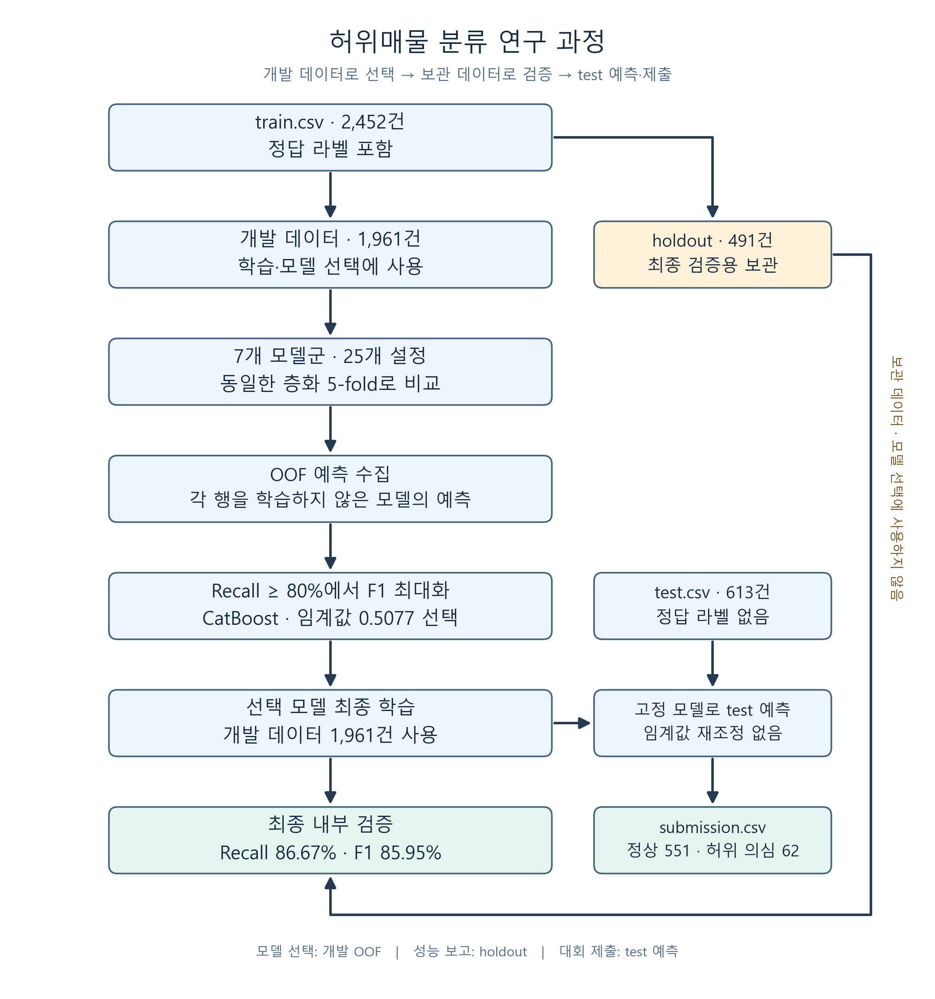
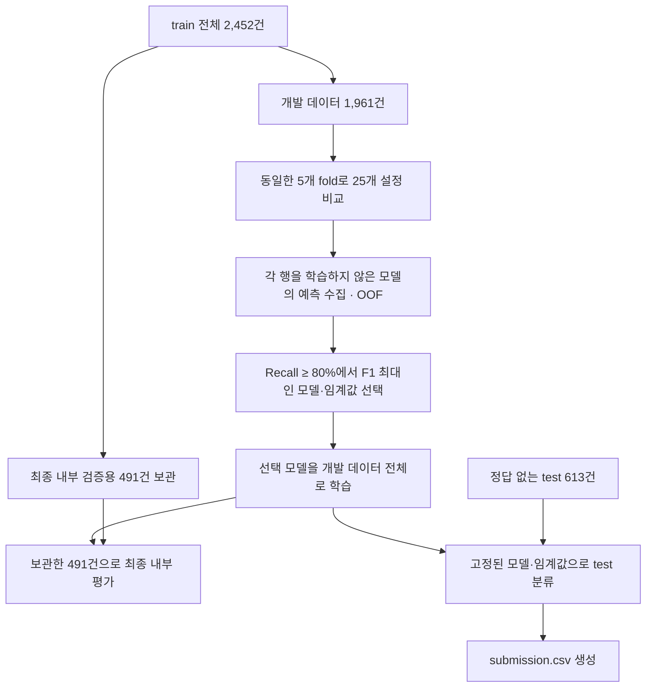

# 부동산 허위매물 분류 모델 최적화

매물 정보를 바탕으로 허위매물 여부를 예측하는 이진 분류 프로젝트입니다. 정답이 있는 `train.csv`로 모델을 학습·검증하고, 정답이 없는 `test.csv`를 분류해 제출 파일을 생성합니다.

**CatBoost를 선정한 직접적인 이유는 ‘Recall 80% 이상’ 조건에서 개발 데이터의 교차검증 F1-score가 가장 높았기 때문입니다.** 전처리 개선, 하이퍼파라미터 후보 비교, 클래스 가중치, 예측 임계값 탐색을 적용했습니다.

2026-10-17 실행 기준 최종 내부 검증 성능은 **Recall 86.67%, F1-score 85.95%**입니다. 이 수치는 train에서 보관한 491건의 평가 결과이며, 대회의 test 채점 점수는 아닙니다.

## 데이터 구성

| 데이터 | 건수 | 정답 라벨 | 역할 |
| --- | ---: | --- | --- |
| [train.csv](train.csv) | 2,452 | 있음 | 모델 학습 및 내부 성능 검증 |
| [test.csv](test.csv) | 613 | 없음 | 예측하고 제출할 대상 |
| 제공된 원본 폴더의 `sample_submission.csv` | 613 | 제출용 예시 값 | 제출 컬럼과 ID 순서의 양식 |

타겟은 `허위매물여부`이며, **0은 정상 매물, 1은 허위매물**입니다. train에는 정상 매물 2,154건, 허위매물 298건이 있습니다.

`test.csv`는 제공받은 파일을 프로젝트 루트에 저장했으며, 원본과 SHA-256 해시가 동일함을 확인했습니다. `sample_submission.csv`는 원본 dataset 폴더에 있는 참고 양식으로, test와 같은 ID 순서의 613행에 예시 값 0이 들어 있습니다. 이 값을 실제 정답으로 취급하지 않습니다.

**test의 정답 라벨 없이도 예측·제출할 수 있습니다.** 내부 Recall/F1 검증에는 train의 라벨을 사용하고, 대회의 실제 test 성능은 공식 채점으로 확인합니다.

## 연구 과정

### 1. 데이터를 나누고 평가 기준을 정했습니다

전체 train 2,452건 중 허위매물은 298건으로 약 12.2%입니다. 정상 매물이 훨씬 많아 Accuracy만 보면 허위매물을 놓치는 모델도 좋아 보일 수 있습니다. 따라서 다음 기준을 적용했습니다.

> **허위매물 Recall ≥ 0.80을 만족하면서 F1-score가 가장 높은 설정을 선택한다.**

Recall은 실제 허위매물 중 탐지한 비율이고, F1은 Precision과 Recall의 조화평균입니다. Recall의 하한을 두고 F1을 최대화하여 미탐과 오탐을 함께 고려했습니다.



[확대 가능한 SVG 이미지](docs/images/research_workflow.svg) · [그림 생성 코드](docs/render_research_workflow.py)

<details>
<summary>흐름도 원본 보기 (Mermaid)</summary>



</details>

- 개발 데이터 80%(1,961건), 최종 내부 검증 데이터인 holdout 20%(491건)로 층화 분할했습니다.
- 시드는 `20261017`로 고정하고, 개발 데이터에서 동일한 층화 5-fold를 사용했습니다.
- **OOF(out-of-fold)**는 각 행을 학습하지 않은 모델이 그 행에 대해 출력한 예측입니다. 이 점수로 모델과 임계값을 선택했습니다.
- 후보 비교에 **25개 설정 × 5-fold = 125번의 학습**을 수행했습니다. 모델 확정 후 개발 데이터 전체로 수행한 최종 학습은 별도입니다.
- 보관한 491건은 모델 학습·조기 종료·후보 선택·임계값 선택에 사용하지 않았습니다.
- 모델 간 F1 동률은 Recall, Average Precision 순으로 결정하고, 그래도 같으면 후보 이름으로 순서를 고정합니다.

Recall 80%는 개발 OOF에서 적용하는 선택 조건입니다. 새 데이터에서 보장되는 하한은 아닙니다.

### 2. 전처리를 통일하고 43개 입력 변수를 구성했습니다

기존 분석에는 학습·검증 데이터에서 인코더와 스케일러를 각각 적합하는 문제 등이 있었습니다. 새 파이프라인은 학습 데이터에서 만든 전처리를 검증·예측에도 동일하게 적용합니다.

입력값과 파생 변수를 합쳐 **43개 입력 변수**를 구성했습니다.

| 변수 | 계산·처리 방식 |
| --- | --- |
| 면적당 보증금·월세·관리비 | 보증금, 월세 또는 관리비 ÷ 전용면적 |
| 방·욕실당 면적 | 전용면적 ÷ 방수 또는 욕실수 |
| 층 비율 | 해당층 ÷ 총층 |
| 월세/보증금 비율 | 월세 ÷ 보증금 |
| 층당 주차대수 | 총주차대수 ÷ 총층 |
| 결측 여부 | 면적·주차대수 등 수치형 변수의 누락 여부 |
| 날짜 정보 | 게재 월·일·요일·기준일부터 경과일 |
| 가격 등의 로그값 | 보증금·월세·면적·주차대수·관리비의 `log1p` 변환 |
| 기타 상태 | 월세가 0인지, 해당층이 총층을 초과하는지 |

- `ID`와 타겟은 모델 입력에서 제외했습니다.
- 분모가 0 이하인 비율은 결측값으로 처리하고 무한값도 결측값으로 바꿨습니다.
- CatBoost에는 중개사무소·플랫폼 등의 **범주형 문자열을 직접 입력**하고 수치형 결측값을 그대로 전달했습니다.
- 다른 모델의 중앙값 대체·스케일링·원핫 인코딩은 **학습 fold 안에서만 적합**하고 검증·예측에는 재사용했습니다.
- 미관측 범주와 범주형 결측값을 처리하며, 필수 컬럼 누락은 명확한 오류로 알립니다.
- train에 중복 입력 행이 있으면 무작위 분할 전에 중단하여 중복에 의한 평가 누수를 막습니다.

구현: [전처리 및 모델 파이프라인](fraud_model.py).

### 3. 같은 조건으로 모델을 비교하고 CatBoost를 선정했습니다

아래는 각 모델군에서 가장 좋았던 설정의 **개발 데이터 OOF 결과**입니다. 이 점수는 모델 선택에 사용했습니다.

| 모델 | Precision | Recall | F1-score |
| --- | ---: | ---: | ---: |
| **CatBoost** | **89.27%** | **87.39%** | **88.32%** |
| HistGradientBoosting | 86.59% | **89.50%** | 88.02% |
| RandomForest | 88.51% | 87.39% | 87.95% |
| LightGBM | 88.84% | 86.97% | 87.90% |
| XGBoost | 86.36% | 87.82% | 87.08% |
| ExtraTrees | 79.18% | 81.51% | 80.33% |
| LogisticRegression | 69.53% | 81.51% | 75.05% |

**Recall만 보면 HistGradientBoosting이 가장 높았습니다.** 사전에 정한 기준은 Recall 80%를 충족하면서 F1을 최대화하는 것이어서 CatBoost를 선택했습니다.

두 모델의 개발 OOF 오류를 비교하면 선택의 의미가 더 분명합니다. 개발 데이터에는 허위매물 238건이 있습니다.

| 개발 데이터의 예측 결과 | CatBoost | HistGradientBoosting |
| --- | ---: | ---: |
| 탐지한 허위매물(TP) | 208건 | 213건 |
| 놓친 허위매물(FN) | 30건 | 25건 |
| 정상 매물을 허위로 오탐(FP) | 25건 | 33건 |

CatBoost는 허위매물 탐지가 5건 적지만 오탐도 8건 적어 F1이 조금 높았습니다. **F1 차이는 약 0.31%p**입니다. 이번 실험의 선정 기준에서는 CatBoost가 1위였으며, 압도적인 우위나 통계적 유의성을 입증한 결과는 아닙니다.

전체 후보의 점수와 임계값은 [25개 설정 비교 기록](artifacts/model_comparison.csv)에 있습니다.

### 4. 하이퍼파라미터와 클래스 가중치를 비교했습니다

탐색은 **Python 반복문과 scikit-learn의 층화 5-fold 교차검증**으로 구현했습니다. 사전에 정한 25개 후보를 평가했습니다.

| 모델군 | 설정 수 | 주요 비교 항목 |
| --- | ---: | --- |
| LogisticRegression | 2 | 규제 강도 |
| RandomForest | 2 | 리프 최소 표본 수 |
| ExtraTrees | 2 | 리프 최소 표본 수 |
| HistGradientBoosting | 3 | 리프 개수 |
| CatBoost | 8 | 깊이, 클래스 가중치, L2 규제 |
| LightGBM | 4 | 리프 개수, 클래스 가중치 |
| XGBoost | 4 | 깊이, 클래스 가중치 |

CatBoost의 비교 범위와 최종 설정은 다음과 같습니다.

| 설정 | 비교 방식·범위 | 최종 선택 | 역할 |
| --- | --- | --- | --- |
| `depth` | 4·5·6·7을 포함한 후보 | **7** | 트리가 표현할 관계의 복잡도 |
| `class_weights` | `[1,1]`, `[1,3]`, `[1,6]` | **[1,3]** | 허위매물 표본의 학습 손실에 3배 가중치 |
| `l2_leaf_reg` | 3·5·7을 포함한 후보 | **7** | 과도한 학습을 억제하는 규제 |
| `iterations` | 고정 | **700** | 부스팅 반복 횟수 |
| `learning_rate` | 고정 | **0.045** | 매 반복의 학습 반영 크기 |

위 범위의 모든 조합을 탐색한 것은 아니며, **정해 둔 8개 CatBoost 조합 중 최선**을 선택했습니다. 이번 실험에서는 early stopping을 사용하지 않고 700회로 고정했습니다.

최종 후보 이름은 `cat_d7_w3`입니다. **모델 자체의 학습 목적은 가중 Logloss 최소화**, **후보를 고르는 기준은 Recall 조건 아래 F1 최대화**로 구분해 적용했습니다.

실제 후보 조합과 고정 파라미터는 [후보 설정 코드](fraud_model.py), 비교·선택 과정은 [학습 코드](train_model.py)에서 확인할 수 있습니다.

### 5. 임계값도 OOF 예측으로 탐색했습니다

각 후보가 출력한 OOF 점수에서 가능한 임계값을 비교했습니다.

1. Precision-Recall 곡선의 점수 임계값 후보를 만들었습니다.
2. Recall이 80% 미만인 임계값을 제외했습니다.
3. 남은 후보 중 F1이 가장 높은 임계값을 선택했습니다.
4. 모델과 임계값을 고정한 뒤 최종 내부 검증을 수행했습니다.

선택된 CatBoost 임계값은 **0.5077266328**입니다. 예측 점수가 이 값 이상이면 허위매물로 분류합니다. 구현은 [`select_threshold`](fraud_model.py)에 있습니다.

**이번 CatBoost에서는 0.5와 0.5077의 OOF 및 최종 holdout 분류 결과가 같았습니다.** 따라서 이번 성능을 “임계값 조정으로 올렸다”고 설명할 수는 없습니다. 전처리·변수 구성·설정 선택을 함께 적용한 결과이며, 각 요소의 개선 기여도는 별도의 제거 실험으로 측정하지 않았습니다.

### 6. 선택을 마친 뒤 최종 내부 성능을 확인했습니다

선택한 CatBoost를 개발 데이터 1,961건 전체로 학습한 뒤 보관한 491건에서 평가했습니다.

| 최종 내부 검증용 491건 | 결과 |
| --- | ---: |
| Precision | **85.25%** |
| Recall | **86.67%** |
| F1-score | **85.95%** |
| Accuracy | 96.54% |
| ROC-AUC | 0.9797 |
| Average Precision | 0.9196 |
| 허위매물 탐지(TP) | **52 / 60건** |
| 놓친 허위매물(FN) | **8건** |
| 정상 매물 오탐(FP) | **9건** |
| 정상 매물 정분류(TN) | 422건 |

고정 모델 기준 95% bootstrap 구간은 Recall **0.7829–0.9337**, F1 **0.7924–0.9180**입니다. 이 구간은 현재 holdout의 표본 불확실성만 나타내며 모델 선택 불확실성을 포함하지 않습니다.

OOF는 모델·임계값 선택에 사용했으므로 선택 편향이 있습니다. **개발 OOF F1 88.32%와 최종 내부 검증 F1 85.95%를 구분해서 보고합니다.**

최종 지표는 [metrics.json](artifacts/metrics.json)의 `holdout_tuned`에 있습니다. 저장된 모델과 제출에 사용한 모델은 모두 **개발 데이터 80%로 학습한 동일 모델**이며, train 2,452건 전체로 재학습한 모델이 아닙니다.

## test 분류와 제출 파일

저장된 전처리·CatBoost·임계값을 그대로 사용해 `test.csv` 613건을 예측했습니다.

| 모델 예측 | 건수 |
| --- | ---: |
| 정상 예측(0) | 551 |
| 허위 의심 예측(1) | 62 |
| 합계 | 613 |

예측한 62건이 실제 허위매물 62건이라는 뜻은 아닙니다. test에는 실제 정답이 없으므로 Recall/F1을 자체 계산하지 않고 **대회 공식 채점으로 test 성능을 확인**합니다.

- [제출 파일](artifacts/operations_test/submission.csv): `ID`, `허위매물여부`.
- 매물별 점수·예측: `artifacts/operations_test/operations_predictions.csv`.
- 데이터 점검 보고서: [operations_validation.json](artifacts/operations_test/operations_validation.json).

원본 test와 저장한 test의 해시, 제출 파일 613건의 ID 순서·0/1 형식을 확인했습니다. 기존 train과 ID 또는 전처리 입력값이 같은 행은 0건이며, test 내부 중복도 0건입니다. 점검 도구의 `awaiting_labels` 상태는 실제 정답이 없어 평가 지표를 산출하지 않았다는 뜻입니다.

## 실행 방법

### 환경 준비

현재 로컬 프로젝트에는 실행 가능한 `.venv`가 준비되어 있습니다. 새 환경에서는 Python 3.13 가상환경을 만들고 의존성을 설치합니다.

```powershell
python -m venv .venv
.\.venv\Scripts\python.exe -m pip install -r requirements.txt
```

### 저장 결과 확인 및 학습 재실행

**[모델_최적화.ipynb](모델_최적화.ipynb)**를 열고 프로젝트 `.venv` Python 커널을 선택하세요. 기본적으로 저장된 비교표·최종 결과를 읽습니다. `RETRAIN = True`로 바꾸면 전체 모델 비교를 재실행합니다. 커널 사용에 필요하면 `ipykernel`을 설치합니다.

```powershell
.\.venv\Scripts\python.exe -m pip install ipykernel
.\.venv\Scripts\python.exe train_model.py
```

업무상 Recall 조건을 바꿔 별도의 실험을 실행하는 예시입니다.

```powershell
.\.venv\Scripts\python.exe train_model.py --min-recall 0.85 --folds 5 --threads 2 --output artifacts_recall85
```

`--min-recall`은 평가 전에 정합니다. 동일 holdout 결과를 보고 반복적으로 모델과 조건을 바꾸면 평가에 과적합할 수 있습니다.

### test 또는 새 매물 예측

```powershell
.\.venv\Scripts\python.exe predict.py --input test.csv --output artifacts/test_predictions.csv
```

결과 컬럼은 `ID`(있는 경우), `허위매물점수`, `허위매물예측`입니다. 입력에는 원본 매물 변수 컬럼이 필요하며, `ID`와 `허위매물여부`는 필수가 아닙니다. 점수는 보정된 실제 사기 확률이 아닙니다.

예측 파일을 대회 제출 형식으로 바꾸려면 노트북이나 Python에서 다음을 실행할 수 있습니다. 현재 데이터에서는 test와 제공된 sample의 ID 순서가 같습니다.

```python
import pandas as pd

predictions = pd.read_csv("artifacts/test_predictions.csv")
submission = predictions[["ID", "허위매물예측"]].rename(
    columns={"허위매물예측": "허위매물여부"}
)
submission.to_csv("artifacts/submission.csv", index=False, encoding="utf-8-sig")
```

이미 만들어 둔 제출 파일은 `artifacts/operations_test/submission.csv`입니다. CSV는 Excel에서도 한글을 읽을 수 있도록 UTF-8 BOM으로 저장합니다. Joblib 모델은 신뢰할 수 있는 파일만 불러오세요.

## 코드와 실험 기록

| 파일 | 내용 |
| --- | --- |
| [fraud_model.py](fraud_model.py) | 변수 생성, 후보 설정, 전처리·모델 파이프라인, 임계값 선택 |
| [train_model.py](train_model.py) | 층화 분할, 5-fold 비교, 최종 학습·평가·저장 |
| [predict.py](predict.py) | 저장 모델·임계값으로 예측 |
| [validate_operations.py](validate_operations.py) | 별도 수집 데이터의 중복 검사 및 확정 라벨 평가 |
| [모델_최적화.ipynb](모델_최적화.ipynb) | 실험 결과 확인 및 재실행용 노트북 |
| [artifacts/model_comparison.csv](artifacts/model_comparison.csv) | 25개 설정의 OOF 비교 및 기본 임계값 지표 |
| [artifacts/fold_metrics.csv](artifacts/fold_metrics.csv) | 후보별 5개 fold의 기본 임계값 평가 |
| [artifacts/threshold_curve.csv](artifacts/threshold_curve.csv) | 선택 모델의 OOF 임계값별 Precision·Recall·F1 |
| [artifacts/metrics.json](artifacts/metrics.json) | 선택 모델·임계값, OOF 및 최종 holdout 지표 |
| [artifacts/run_manifest.json](artifacts/run_manifest.json) | 원본 해시, 분할 행 번호, 시드, 후보 설정, 패키지 버전 |
| `artifacts/fraud_detector.joblib` | 전처리·모델·선택 임계값 |
| `artifacts/holdout_predictions.csv` | 최종 내부 검증 행의 점수와 예측 |
| `artifacts/oof_predictions.csv` | 개발 데이터의 후보별 OOF 예측 |
| `artifacts/evaluation.png` | 모델 비교, PR 곡선, 혼동행렬 |

모델 바이너리·행별 점수·이미지는 로컬에서 생성되고 Git에서는 제외됩니다. 학습을 실행하면 다시 생성할 수 있습니다.

## 추가 수집 매물의 운영 검증

대회 제출과 별도로, 실제 판정이 확보된 추가 매물의 성능을 평가하려면 다음 명령을 사용합니다.

```powershell
.\.venv\Scripts\python.exe validate_operations.py --data 수집매물.csv
```

- 저장된 모델과 임계값을 고정하며 학습·임계값 재탐색을 수행하지 않습니다.
- 기본 라벨은 `허위매물여부`의 확정된 0/1입니다. 다른 컬럼은 `--label-column 실제판정`처럼 지정합니다.
- 원본 해시를 확인하고, 기존 train 전체와 ID 또는 전처리 입력값이 같은 행이나 새 배치 내 중복이 있으면 평가를 중단합니다. 중복 중단 시 상태 보고서를 기록하고 종료 코드 2를 반환합니다.
- 라벨이 없으면 예측만 저장합니다. 일부 라벨만 있으면 확정 행만 평가하고 라벨 확보율을 기록합니다. 확인 대상을 선택한 방식에 따라 표본 편향이 생길 수 있습니다.
- 한 클래스만 있으면 계산할 수 없는 지표를 `null`로 표시합니다. 허위매물이 없는 표본의 Recall은 측정할 수 없습니다.

결과는 `artifacts/operations/operations_validation.json`과 `operations_predictions.csv`에 저장됩니다. 기존 train 재사용 차단 기록은 [operations_existing_data_check](artifacts/operations_existing_data_check/operations_validation.json)에 있습니다.

`게재일`은 수집일과 다릅니다. test의 게재일 범위는 2023-06-19~2025-02-17, train은 2023-04-28~2025-03-03으로 겹칩니다. 현재 파일만으로 미래 시점의 운영 성능을 확인할 수는 없습니다. ID·입력값 일치 검사만으로 모든 재등록·유사 매물을 탐지할 수 있는 것도 아닙니다.

## 검증 기록과 해석 범위

- 전체 125개 fold 학습과 최종 모델 학습을 완료했습니다.
- 저장 모델을 다시 불러온 점수·평가 지표가 저장 결과와 일치함을 확인했습니다.
- 미관측 범주, 결측값, 0·무한값, 컬럼 순서 변경과 필수 컬럼 누락 처리를 점검했습니다.
- 최적화 노트북의 모든 코드 셀 실행과 예측 CLI 실행을 확인했습니다.
- 운영 검증 도구의 라벨 유무·일부 라벨·단일 클래스·중복 차단은 별도의 기술 점검으로 확인했습니다. 이 점검을 실제 운영 성능으로 보고하지 않습니다.
- 최종 내부 검증에는 허위매물이 60건뿐입니다. 새로운 시점이나 처음 보는 중개사무소의 성능은 별도 검증이 필요합니다.
- 이번 holdout도 기존 프로젝트 데이터의 일부입니다. 새로 확보한 외부 검증 데이터나 train 전체 재학습 모델의 평가 결과로 해석하지 않습니다.

[허위매물 전처리탐지_문제.ipynb](<허위매물 전처리탐지_문제.ipynb>)는 초기 분석 기록으로 보존했습니다. 당시에는 학습/검증 인코더·스케일러 별도 적합, 검증 타겟으로 회귀 모델 재학습, 동일 검증 데이터로 조기 종료·임계값 선택, 파생 변수 불일치와 정의되지 않은 결과 변수 등의 문제가 있었습니다. 최신 실행 경로는 위 Python 스크립트와 최적화 노트북입니다.

기존 기록의 Recall 0.8000, F1 0.6667은 다른 분할과 평가 절차의 수치이므로 이번 holdout 점수와 직접적인 개선 폭으로 비교하지 않습니다.

구현 참고: [scikit-learn 임계값 교차검증](https://scikit-learn.org/stable/modules/classification_threshold.html), [CatBoost 범주형 처리](https://catboost.ai/docs/en/features/categorical-features).
